<h1 align="center">Hi, I'm Jan 👋</h1>

  Software engineer at <a href="https://super.xyz">Super</a>, building web products with TypeScript, Vue and React.

  <a href="https://portfolio-website-pearl-one-53.vercel.app">Portfolio</a>

## About me

- 💼 Software engineer at [Super](https://super.xyz)
- 🌐 Mostly frontend: Vue 3 at work, React and Next.js on the side
- 🧰 Also at home in Java (Spring Boot, JavaFX), C# (.NET, EF Core) and Python
- 🚀 Latest side project: a bilingual Next.js 16 site for a print shop

## Tech stack

  

## Featured projects

| Project | What it is | Built with |
| --- | --- | --- |
| [TiskaraHladProject](https://github.com/JanJedvaj/TiskaraHladProject) | Croatian/English marketing and product catalogue site for a print shop, with an admin catalogue editor | Next.js, React, Tailwind, Supabase |
| [InterferenceInjectionTool](https://github.com/JanJedvaj/InterferenceInjectionTool) | Upload RF signals, inject configurable interference, preview in real time and export | React, TypeScript, Flask |
| [BirdProject](https://github.com/JanJedvaj/BirdProject) | Data pipeline that classifies bird species from audio and generates reports | Python, Kafka, MongoDB, MinIO, Docker |
| [InternshipPortal](https://github.com/JanJedvaj/InternshipPortal) | Full-stack portal where companies post internships and students apply | C#, .NET |
| [HockeyGameSpringBoot](https://github.com/JanJedvaj/HockeyGameSpringBoot) | 2D air hockey with socket multiplayer, RMI chat and replays | Java, JavaFX |

## Contributions

<picture>
  <source media="(prefers-color-scheme: dark)" srcset="https://raw.githubusercontent.com/JanJedvaj/JanJedvaj/output/pacman-contribution-graph-dark.svg" />
  <source media="(prefers-color-scheme: light)" srcset="https://raw.githubusercontent.com/JanJedvaj/JanJedvaj/output/pacman-contribution-graph.svg" />
  
</picture>
